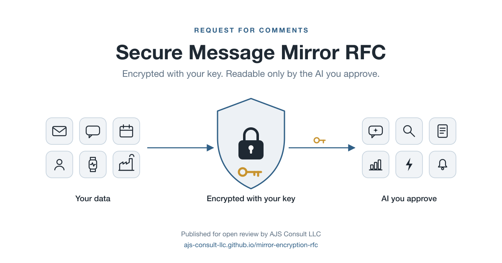

# Mirror Encryption: Security Architecture



A request for comments on encrypting private data mirrors so that only the devices and AIs a
user approves can read them. Owned by AJS Consult LLC; edited by Aaron Soellinger; licensed
CC BY 4.0.

- **Read it:** https://ajs-consult-llc.github.io/mirror-encryption-rfc/ (HTML, with a PDF download)
- **Comment or propose a change:** see [CONTRIBUTING.md](CONTRIBUTING.md). Only signed, attributed
  submissions are official (Appendix A of the document).
- **Report a vulnerability in the running service:** privately, as chapter 17 says. Never in an issue.

## How this repository works

The editor writes in a Claude Doc. This repository is the system of record. A tool moves the
text between them, so neither copy is ever retyped by hand.

```
Claude Doc ──export──▶ tools/rfcsync.py split ──▶ chapters/*.qmd ──▶ pull request ──▶ main ──▶ the published book
     ▲                                                                                    │
     └──── applied by Claude ◀── tools/rfcsync.py plan (three-way) ◀──── merged changes ──┘
```

| Path | What it is |
| --- | --- |
| `chapters/*.qmd`, `index.qmd` | The document, one chapter per section of the doc. Written by `split`. |
| `figures/*.png` | The diagrams, captured from the doc. Named after each diagram's caption. |
| `_quarto.yml` | Book configuration, generated from `tools/_quarto.template.yml` by `split`. |
| `.sync/base.md` | The last export: the merge base for bringing GitHub changes back to the doc. |
| `.sync/widgets.json` | The doc's diagrams, by caption, with their ids in the doc. |
| `tools/rfcsync.py` | `split`, `join`, `check`, `plan`, `decode`, `figure`. Standard library only. |
| `.claude/skills/rfc-sync/` | The procedure a Claude session follows for each direction. |
| `SUBMISSIONS.md` | The log of official submissions and what was decided. |

In a Claude Code session in this repository, ask to **publish the doc** (doc to GitHub) or to
**import merged changes** (GitHub to doc).

## Posting an update

Every update is a GitHub release: the release is the one source, so the site's Updates page,
the feed and the subscriber email cannot disagree.

1. Publish a release. On GitHub: Releases, Draft a new release, a new tag such as
   `round-1-open`, a title and the text in Markdown, then Publish. Or:
   `gh release create round-1-open --title "Round 1 is open" --notes-file post.md`.
   The Updates page and the feed update within a few minutes.
2. In a Claude Code session in this repository, ask to **email the update**. Claude adds new,
   consented sign-ups to the list (`tools/announce.py sync`), makes a draft from the release
   (`tools/announce.py draft <tag>`), shows it to you, and sends only when you say so.

Setup, once: copy `announce.example.json` to `.announce.json` and fill it in (it is not
committed); a Tally form with an email question and a consent checkbox; its API key in Secret
Manager under the name in `.announce.json`; the form's link in `tools/review.json`, which holds every fact about the round:
dates, links and the security contact.

## Building locally

```sh
python3 -m unittest discover -s tests      # the sync tool's tests
python3 tools/rfcsync.py check             # the chapters still equal the last export
quarto render                              # HTML and PDF into _book/
```

Quarto 1.11 or later. PDF is rendered with Typst, which Quarto includes; no LaTeX is needed.
