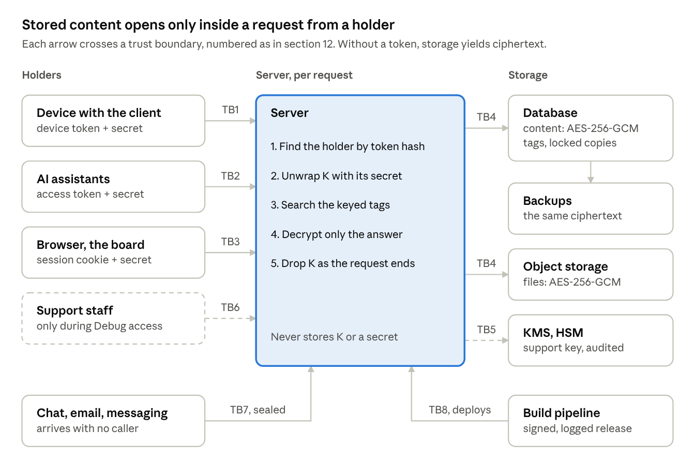

# 3. System overview

The server holds K only inside a request that presents a holder's token and secret. Storage, backups and logs hold ciphertext, keyed tags and token hashes.

The server is a FastAPI application on Python 3.11, on Google Cloud, behind TLS. Dashed parts exist only while the user has Debug access on.
