# How it works

The same machinery seen twice: first what happens to the account key, then what happens to the data.

## Key management lifecycle

The account key is created once on the desktop, opened only inside approved requests, changed only by adding or removing locked copies, and destroyed by deleting every copy.

<!-- diagram: where the account key lives · 2 places in the clear -->
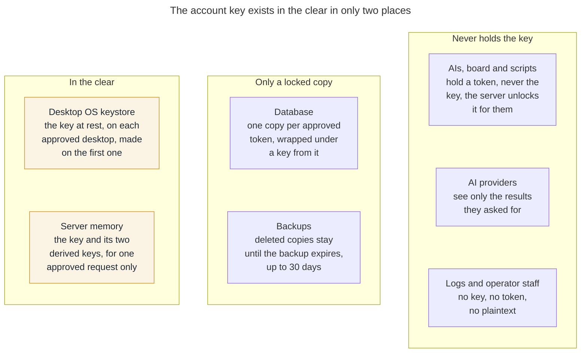

Only a desktop keystore holds the account key at rest. The server holds it in memory for one request at a time; everything else holds a locked copy, a token, or nothing.

Every change to who can read the mirror is a copy of the account key added or deleted; the account key itself changes only if it is rotated.

### Create

On first run, the desktop app generates the account key from 256 random bits and stores it in the OS keystore. It then signs in, receives its own desktop token, wraps the account key under a key derived from that token, and uploads only that locked copy. The server stores the copy beside the token’s hash; it never sees the account key and never keeps the token.

<!-- diagram: create · 4 parties -->
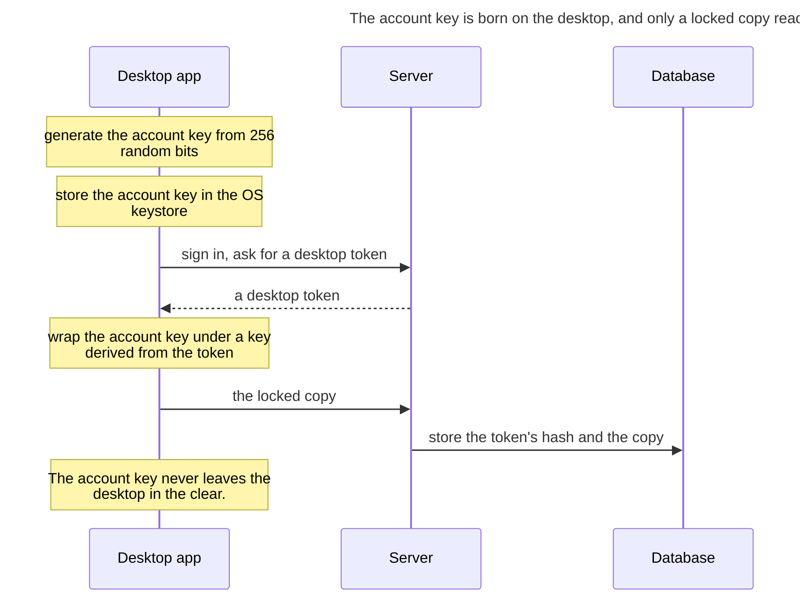

**Why this is best practice.** The key is made from a cryptographically secure random source on the device that will hold it, which is what [NIST SP 800-133 Rev. 2](https://csrc.nist.gov/pubs/sp/800/133/r2/final) recommends, and it is stored in the OS key store, hardware-backed where the platform offers it, rather than in a file. The server receives only a wrapped copy ([NIST SP 800-38F](https://csrc.nist.gov/pubs/sp/800/38/f/final)), so nothing the server stores can open the data. That separation is the core idea of client-side and envelope encryption.

### Read

A reader's request carries its token. The server finds the reader's locked copy by the token’s hash, derives the unwrapping key from the token with HKDF, and opens the account key in memory. It looks up the query's tags, decrypts only the candidate rows and returns the results. When the request ends, the account key is dropped; nothing of it is written to disk or logs.

<!-- diagram: read · 3 parties -->
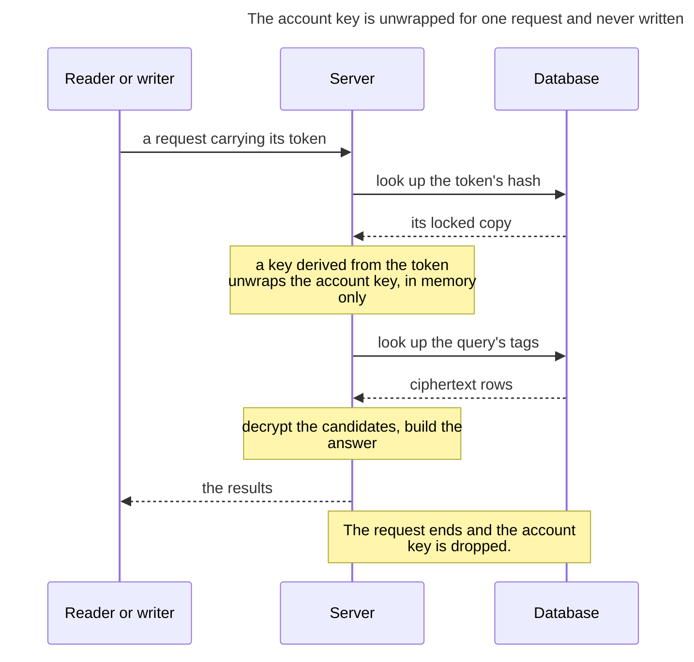

**Why this is best practice.** The key is opened only in memory, only for one request, and then dropped. That follows [NIST SP 800-57 Part 1](https://csrc.nist.gov/pubs/sp/800/57/pt1/r5/final): keep plaintext keys out of persistent storage and out of logs, and limit how long they exist. The unwrapping key is derived from the token with HKDF ([RFC 5869](https://www.rfc-editor.org/rfc/rfc5869)), the standard way to turn a high-entropy secret into a key, and the server looks tokens up by hash, so its stored data holds no usable credential.

### Update

When the user approves a new reader or writer, the approval happens inside a session that already holds the account key. The server makes a new token, wraps the account key under a key derived from it, stores that copy beside the new token’s hash, and hands the new token to the new holder once. Renewing a token follows the same steps, then deletes the old token's hash and copy. The account key itself does not change.

<!-- diagram: update · 4 parties -->
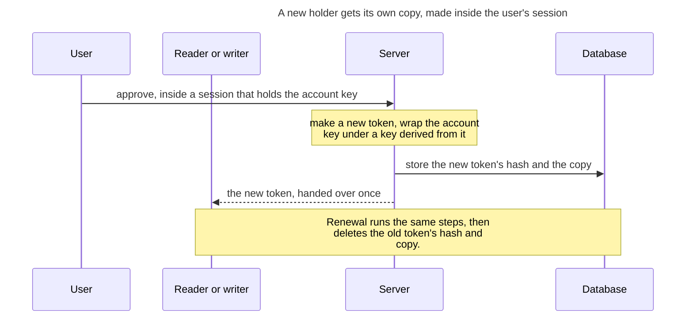

**Why this is best practice.** Granting access means wrapping the same key once more, not re-encrypting data or sharing one credential among holders. This is envelope encryption, the pattern cloud key-management services use, and it means every holder can be revoked on its own. Handing a new token over once and rotating it on renewal follows the OAuth security best current practice ([RFC 9700](https://www.rfc-editor.org/rfc/rfc9700)).

### Expire

Every token has an end time, stored beside its hash. The server refuses an expired token on every request, and a periodic sweep then deletes the expired token's hash and its copy of the account key. A holder renews before its end time by presenting its current token, which follows Update; a refresh token presented twice revokes its whole chain. The lifetime for each kind of holder is question 4. Backups can still hold an expired copy for up to 30 days (see What it does not protect).

<!-- diagram: expire · 3 parties -->
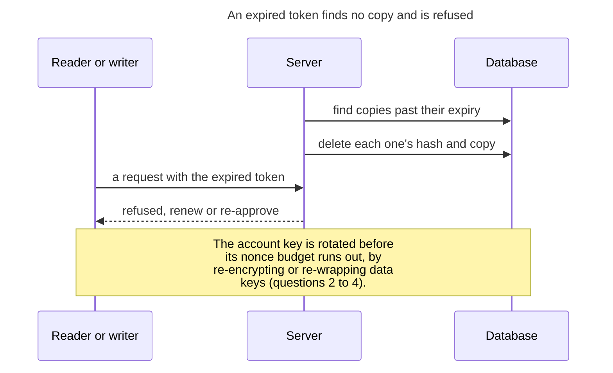

**Why this is best practice.** Every token has a fixed lifetime, and its copy of the key is deleted when that lifetime ends, so a leaked token stops working without anyone acting. Bounded lifetimes are what [RFC 9700](https://www.rfc-editor.org/rfc/rfc9700) recommends for tokens, and NIST calls them cryptoperiods ([SP 800-57 Part 1](https://csrc.nist.gov/pubs/sp/800/57/pt1/r5/final)).

### Delete

The user ends access in one of three ways, each from an approved device:

- **Revoke one reader or writer** (an AI, a browser session, a script). The server deletes that token's hash and its copy of the account key. That holder is cut off at once, and every other holder keeps working.
- **Remove a lost device.** The same deletion, for the device's token. Recovery then runs as an Update from a device the user still has.
- **Delete the account.** The server deletes every copy and every row. With no copy of the account key left, nothing live can open the mirror.

Backups still hold old copies until they expire, up to 30 days. If every holder is lost, the next desktop makes a new account key and collects again from the sources.

<!-- diagram: delete · 4 parties -->
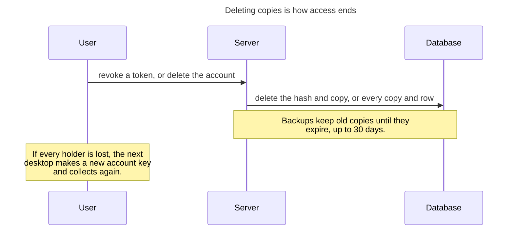

**Why this is best practice.** Deleting every copy of the key, as account deletion does, is cryptographic erase, a sanitization method NIST recognizes ([SP 800-88 Rev. 1](https://csrc.nist.gov/pubs/sp/800/88/r1/final)). It works at once, even when ciphertext remains in storage the user cannot reach. Revoking a single holder is weaker: it ends that holder's access through the service, but other copies of the same key remain. Revocation takes effect server-side on the token's next use, as OAuth token revocation specifies ([RFC 7009](https://www.rfc-editor.org/rfc/rfc7009)). The known exception is backups, which keep old copies for up to 30 days.

## How data moves

Five flows cover everything the system does. In each one, the account key is opened only inside a request that presents an approved token.

### Collect and push

New messages are locked on the user's own computer before they go anywhere, so the service stores only ciphertext, which opens only inside an approved request.

1. The desktop app reads a new message from a source on the desktop: mail, messaging apps, team chat, a calendar.
2. It encrypts the message under the content key and computes its search tags under the tag key, both derived from the account key.
3. It uploads the ciphertext and tags over TLS, presenting its own token. The server stores them and cannot open them without an approved token.
4. The message is searchable as soon as it is stored.

<!-- diagram: collect and push · 4 parties -->
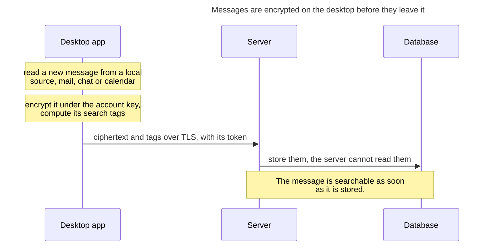

Only ciphertext and tags leave the desktop; the server cannot open them without an approved token.

**Why this is best practice.** Encrypting on the client before upload, so the storage provider holds only ciphertext, is the model behind end-to-end encrypted storage and client-side encryption. Each message is sealed with AES-256-GCM ([NIST SP 800-38D](https://csrc.nist.gov/pubs/sp/800/38/d/final)), an authenticated cipher that detects any change to the ciphertext, and it is bound to its account and message ids as associated data ([RFC 5116](https://www.rfc-editor.org/rfc/rfc5116)), so a row cannot be moved to another account or message. TLS protects the upload in transit ([RFC 8446](https://www.rfc-editor.org/rfc/rfc8446)).

### Approve a reader or writer

Nothing gets access unless the user says yes, and every approved AI, browser or device gets its own key that can be cancelled on its own.

1. The user approves it: OAuth consent for an AI, the web app opened from the desktop, or a matching code for a second device.
2. Inside the user's own approved session, the server makes a new token and a copy of the account key locked under it.
3. The token is handed to the new reader or writer once. The server keeps only its hash.

<!-- diagram: approve a reader or writer · 4 parties -->
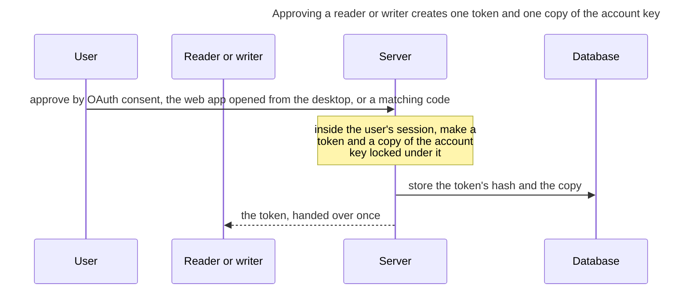

The server keeps only the token’s hash; the token itself is handed over once.

**Why this is best practice.** AI clients are approved through OAuth consent with PKCE, as the OAuth security best current practice requires ([RFC 9700](https://www.rfc-editor.org/rfc/rfc9700)), and a second device is approved by comparing a short code on both screens, a relative of the device flow in [RFC 8628](https://www.rfc-editor.org/rfc/rfc8628). Giving each holder its own token and its own wrapped copy of the key is least privilege: no credential is shared, so each one can be revoked alone. Storing only a hash of each token means a database copy yields no usable credential, as [NIST SP 800-63B](https://pages.nist.gov/800-63-3/sp800-63b.html) requires for stored passwords.

### Search and retrieve

An approved AI gets answers in well under a second, and the data is unlocked only for that one question, then locked again.

1. A reader sends a query with its token.
2. The server finds the token's copy by its hash and unlocks the account key for this request.
3. It turns the query into tags, finds the candidates in the index, decrypts only those, and checks the real match.
4. It returns the results and drops the account key.

<!-- diagram: search and retrieve · 3 parties, one request -->
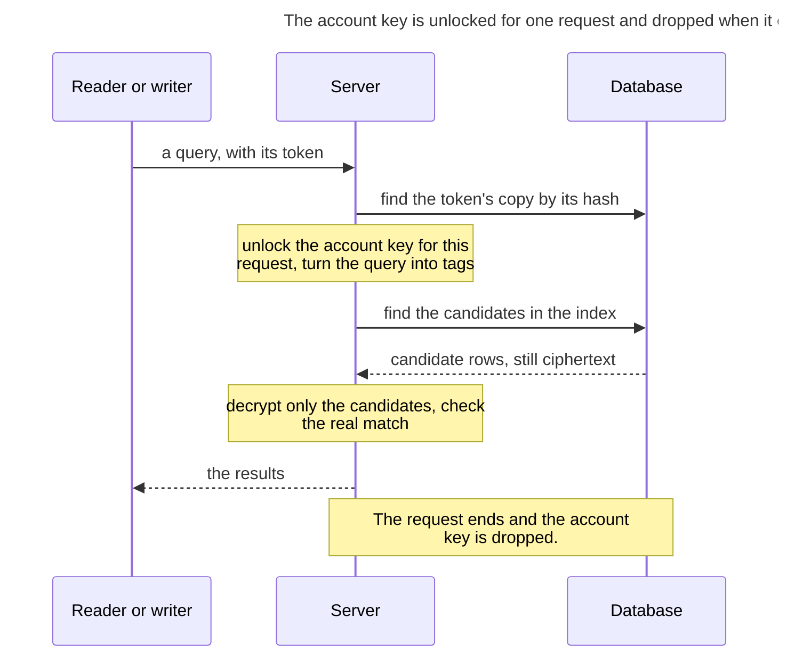

Only the candidate rows are decrypted, and the account key lives only for the request.

**Why this is best practice.** Search runs on keyed tags, the standard construction for searching encrypted data ([Song, Wagner and Perrig, IEEE S&P 2000](https://people.eecs.berkeley.edu/~dawnsong/papers/se.pdf)). The query is reduced to trigrams and the real match is checked afterwards, as in production regex search ([Russ Cox, trigram index](https://swtch.com/~rsc/regexp/regexp4.html)). Holding the key in memory for one request only follows [NIST SP 800-57 Part 1](https://csrc.nist.gov/pubs/sp/800/57/pt1/r5/final) on limiting how long plaintext keys exist. The known cost is access-pattern leakage ([Cash et al., CCS 2015](https://eprint.iacr.org/2016/718)), which question 1 puts to reviewers.

### Update

Edits by an approved AI or by the user are locked the moment they are saved, and every other reader sees them on its next request.

1. A writer sends a change with its token: an AI's tool call, or an edit on the web app.
2. The server unlocks the account key, encrypts the change, recomputes its tags and stores it.
3. Every reader sees it on its next request.

<!-- diagram: update · 4 parties -->
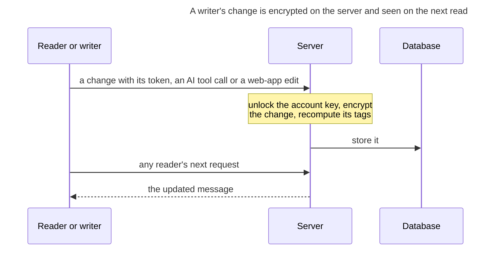

Writes follow the same rule as reads: the account key is opened only inside the writer’s request.

**Why this is best practice.** A write uses the same authenticated encryption as a read, so the server never stores an edited row in the clear. Every write gets a fresh random nonce, which is what keeps AES-GCM secure when the same key encrypts many messages ([NIST SP 800-38D](https://csrc.nist.gov/pubs/sp/800/38/d/final), section 8). The tags are recomputed with HMAC-SHA256 ([FIPS 198-1](https://csrc.nist.gov/pubs/fips/198-1/final)), so the search index never falls out of step with the content.

### Revoke and recover

Cutting off an AI or a lost device takes effect at once and touches no one else; a replacement device is approved like any other.

- **Revoke.** Deleting a token's hash and copy cuts that reader or writer off at once.
- **A lost desktop.** From another approved device the user revokes it, then approves a new desktop, which receives the account key through its own copy.
- **The only desktop lost.** A recovery code made at setup is one more token, printed and kept offline, with its own locked copy. Presented from a new desktop, it approves that desktop. Without one, the mirror starts again with a new account key even if AI readers still hold tokens, because a reader's token cannot approve a device.
- **Every holder lost.** The mirror cannot be read. A new desktop makes a new account key and collects again from the sources.

<!-- diagram: revoke and recover · 4 parties -->
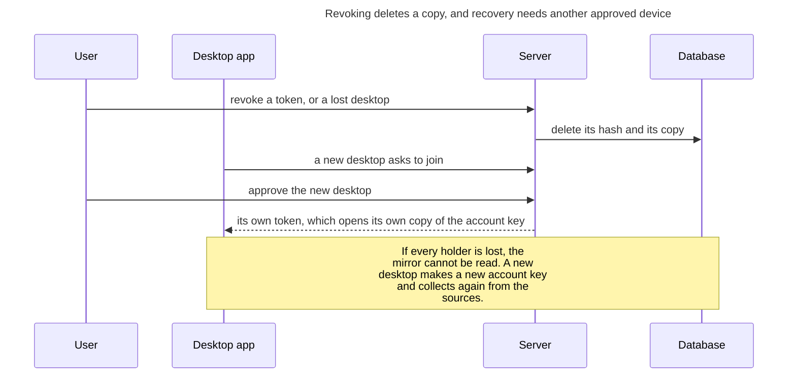

Cutting off a reader is one deletion; a replacement desktop is approved like any other holder.

**Why this is best practice.** Revoking a token server-side, so that it fails on its next use, is what OAuth token revocation specifies ([RFC 7009](https://www.rfc-editor.org/rfc/rfc7009)). Deleting that token's copy ends its access through the service. Only deleting every copy is cryptographic erase, the sanitization method NIST recognizes ([SP 800-88 Rev. 1](https://csrc.nist.gov/pubs/sp/800/88/r1/final)). Recovering through another approved device, rather than through a reset the operator controls, keeps the operator unable to open the data. End-to-end encrypted services use the same approach, and when every holder is lost the honest result is that the data cannot be read.
