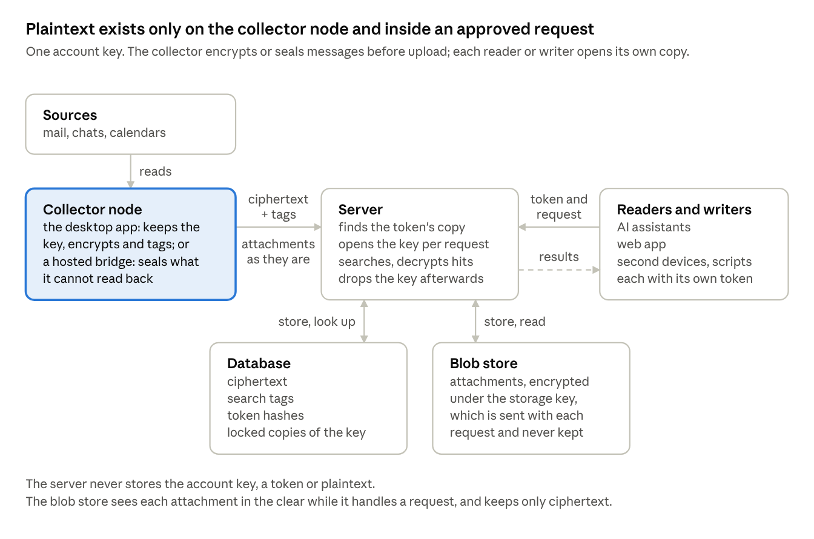

# 4. The design on one page

There is one key, one kind of token, and two algorithms: AES-256-GCM encrypts everything, and SHA-256 does the rest as a hash, as HMAC and as HKDF. Everything else follows from them.

<!-- diagram: Figure 4.1. The whole design: one account key, one kind of token, a database and a blob store -->

**Figure 4.1.** The whole design: one account key, one kind of token, a database and a blob store · [Text version](14-appendix-b-the-diagrams-as-text.md#the-whole-design-1-key-1-kind-of-token)
<!-- /diagram -->

- **One key.** On installation, the desktop sync application asks the operating system for 256 random bits, and those bits are the "account key". The user's OS key store holds the account key and releases it only to approved application(s). The account key never encrypts anything itself. Instead, HKDF-SHA256 turns it into two working keys, one per job:  (1) a content key that encrypts each message (AES-256-GCM) and (2) a tag key that computes the search tags (HMAC-SHA256). A third, the storage key, is derived the same way for attachments. They are re-derived whenever they are needed, so nothing extra is stored, and learning one working key reveals neither the other nor the account key. Because both come from the one account key, a reader that can open its copy of the account key can both read messages and search them.

> Why this is current best practice: a full-strength random key from an approved generator ([NIST SP 800-133 Rev. 2](https://csrc.nist.gov/pubs/sp/800/133/r2/final)); one key per purpose, never one key for two jobs ([NIST SP 800-57 Part 1 Rev. 5](https://csrc.nist.gov/pubs/sp/800/57/pt1/r5/final), key separation); and working keys derived with HKDF ([RFC 5869](https://www.rfc-editor.org/rfc/rfc5869)), the extract-then-expand construction NIST approves in [SP 800-56C Rev. 2](https://csrc.nist.gov/pubs/sp/800/56/c/r2/final) and the one TLS 1.3 uses for all its keys ([RFC 8446](https://www.rfc-editor.org/rfc/rfc8446)).

- **Encrypted at the source.** The desktop app encrypts each message with AES-256-GCM, bound to the account and the message's id, and computes its search tags with HMAC-SHA256. Only ciphertext and tags leave the desktop. Attachments are the exception: the desktop uploads them as they are, and the storage service encrypts each one under a storage key that is derived from the account key, supplied with the request and never kept (see Decisions made to simplify).

> Why this is current best practice: AES-256-GCM is the NIST-approved authenticated encryption mode ([SP 800-38D](https://csrc.nist.gov/pubs/sp/800/38/d/final), over AES in [FIPS 197](https://csrc.nist.gov/pubs/fips/197/final)), so tampering is detected, not just hidden. Binding each ciphertext to its account and message id as associated data follows the AEAD design in [RFC 5116](https://www.rfc-editor.org/rfc/rfc5116), which stops a stored ciphertext being swapped into another row or account. HMAC-SHA256 is the approved keyed hash ([FIPS 198-1](https://csrc.nist.gov/pubs/fips/198-1/final)), and keyed tags over fragments are the classic construction for search over encrypted data ([Song, Wagner and Perrig, IEEE S&P 2000](https://people.eecs.berkeley.edu/~dawnsong/papers/se.pdf)). Its known limit, that equal fragments produce equal tags, is question 1, and GCM's nonce limit is question 2.

- **One kind of token.** Every reader or writer the user approves gets a random 256-bit token: a connected AI, the web app, a second device, a script. The server keeps the token's SHA-256, to find it, and one copy of the account key locked under a key derived from the token (AES-256-GCM, the cipher that also encrypts messages). One token, one copy.

> Why this is current best practice: high-entropy bearer tokens are the OAuth standard ([RFC 6750](https://www.rfc-editor.org/rfc/rfc6750)), and short lifetimes with refresh-token rotation follow the OAuth security best current practice ([RFC 9700](https://www.rfc-editor.org/rfc/rfc9700)). Keeping only a hash of each token means a database copy yields no usable credential, the same rule [NIST SP 800-63B](https://pages.nist.gov/800-63-3/sp800-63b.html) sets for stored passwords. Locking one copy of the account key per holder with AES-256-GCM, an authenticated cipher that NIST also approves for wrapping keys ([NIST SP 800-38F](https://csrc.nist.gov/pubs/sp/800/38/f/final)) is envelope encryption, the pattern cloud key-management services use.

- **Search without plaintext.** Inside an approved request the server unlocks the account key, turns the query into tags, finds candidates in an ordinary database index, and decrypts only those.

> Why this is current best practice: keyed tags are the standard construction for search over encrypted data ([Song, Wagner and Perrig, IEEE S&P 2000](https://people.eecs.berkeley.edu/~dawnsong/papers/se.pdf)). Filtering on trigrams and then checking the real match is how production regex search works ([Russ Cox, Regular Expression Matching with a Trigram Index](https://swtch.com/~rsc/regexp/regexp4.html)). The known cost is access-pattern leakage ([Cash et al., Leakage-Abuse Attacks Against Searchable Encryption, CCS 2015](https://eprint.iacr.org/2016/718)), which is why this design names it as a limit and asks reviewers about it (question 1).

- **Revocation is deletion.** Deleting a token's hash and its copy cuts that reader or writer off at once.

> Why this is current best practice: revoking one holder deletes its only way to open the key through the service. Deleting every copy, as account deletion does, is cryptographic erase, a sanitization method NIST recognizes ([SP 800-88 Rev. 1](https://csrc.nist.gov/pubs/sp/800/88/r1/final)). Revoking a token server-side, effective on its next use, is what OAuth token revocation specifies ([RFC 7009](https://www.rfc-editor.org/rfc/rfc7009)). Two gaps remain: backups hold old copies for up to 30 days, and the other copies of the same key stay valid (see What it does not protect).

The server never stores the account key, a token or plaintext. It holds the account key in memory only while it answers a request from an approved token. An attested worker, if the user unlocks one, is the exception: it holds its own key for the length of its lease (5.5).

**One rule for every credential.** Each credential has its own locked copy of the account key. Every hand-off opens the copy with the old credential, locks a new copy under the new one, and deletes the old. An OAuth authorization code, the web app's connect code and a renewed token are all hand-offs of this kind, so the server never needs to store a token while one is in transit. A recovery code is the same thing on paper.
