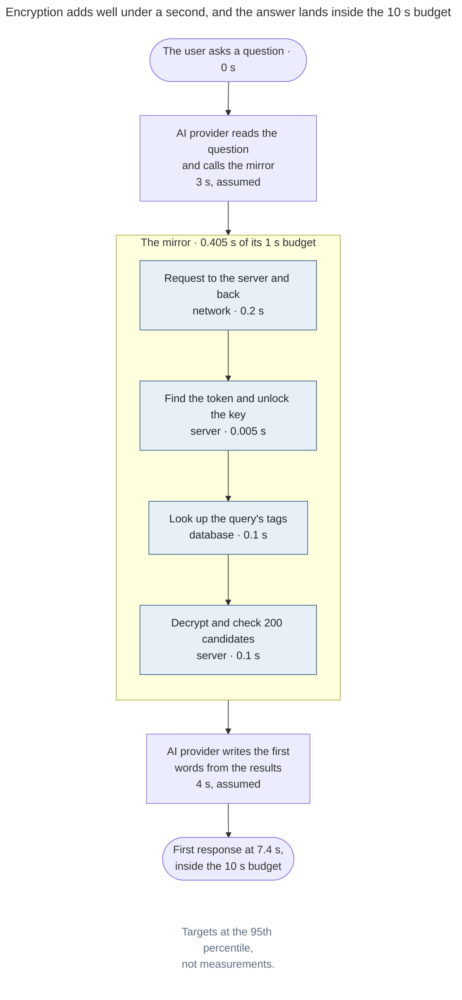

# Latency budget

Encryption costs the answer well under a second: the mirror's whole share is targeted at 0.4 seconds, inside a 1-second budget, so most of the 10 seconds belongs to the AI.

<!-- diagram: latency budget · targets at the 95th percentile, not measurements -->

These are targets, not measurements. Before launch they are measured on a synthetic account the size of the largest real one, about 1.6 million messages. A new message is searchable once its upload completes; the target is under 2 seconds from arriving on the desktop.
