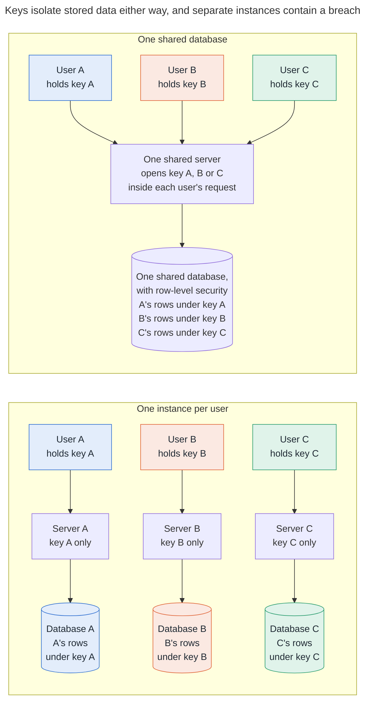

# Appendix A. Single or multi-tenant

For stored data the choice barely matters, because each user's rows are locked under that user's own key. It matters for the server's memory, for cost, and for who can see metadata.

|  | One shared database | One database per user |
| --- | --- | --- |
| Stored data | Isolated by each user's key: another user's rows, served by mistake, do not decrypt | The same, plus physical separation |
| A compromised server | Sees what every active user's requests decrypt while it is compromised | Sees one user's |
| Metadata: counts, sizes, times | Visible to the operator. Per-user tag keys stop matching across users. | Visible to whoever runs it |
| Deleting a user | Delete their copies of the account key and their rows | Delete the database |
| Cost and operations | One database to run | One per user |

<!-- diagram: shared vs dedicated · 3 users -->

The recommendation is one codebase that runs either way. Shared by default, with row-level security in the database as a second line behind the keys. A dedicated instance, run by the operator or by the user, for anyone who wants the smaller blast radius. The keys stay with the user in both.
