<!-- generated by tools/rfcsync.py from diagrams/*.mmd: not in the doc, and join skips it -->
# Appendix B. The diagrams as text

Every diagram in this document, written out: a description in words, for screen readers and search, and its source in [Mermaid](https://mermaid.js.org), which GitHub draws and anyone can edit in a pull request. The pictures in the chapters are exported from the editor's document; these text versions are kept in step with them, and the sync tool reports any picture that has changed since its text version was last checked.

## Figure 4.1. The whole design: one account key, one kind of token, a database and a blob store

*Plaintext exists only on the collector node and inside an approved request*

In [4. The design on one page](07-the-design-on-one-page.md). One account key. The collector encrypts or seals messages before upload, and each reader or writer opens its own copy. The collector node reads the sources (mail, chats, calendars). It is either the desktop app, which keeps the key, encrypts each message and computes search tags, or a hosted bridge, which seals what it cannot read back. It sends ciphertext and tags, and attachments as they are, to the server. Readers and writers (AI assistants, the web app, second devices and scripts), each with its own token, send a token and request to the server. The server finds the token's copy, opens the key per request, searches and decrypts hits, returns the results and drops the key afterwards. It stores and looks up ciphertext, search tags, token hashes and locked copies of the key in the database, and stores and reads attachments in the blob store, encrypted under the storage key, which is sent with each request and never kept. The server never stores the account key, a token or plaintext. The blob store sees each attachment in the clear while it handles a request, and keeps only ciphertext.

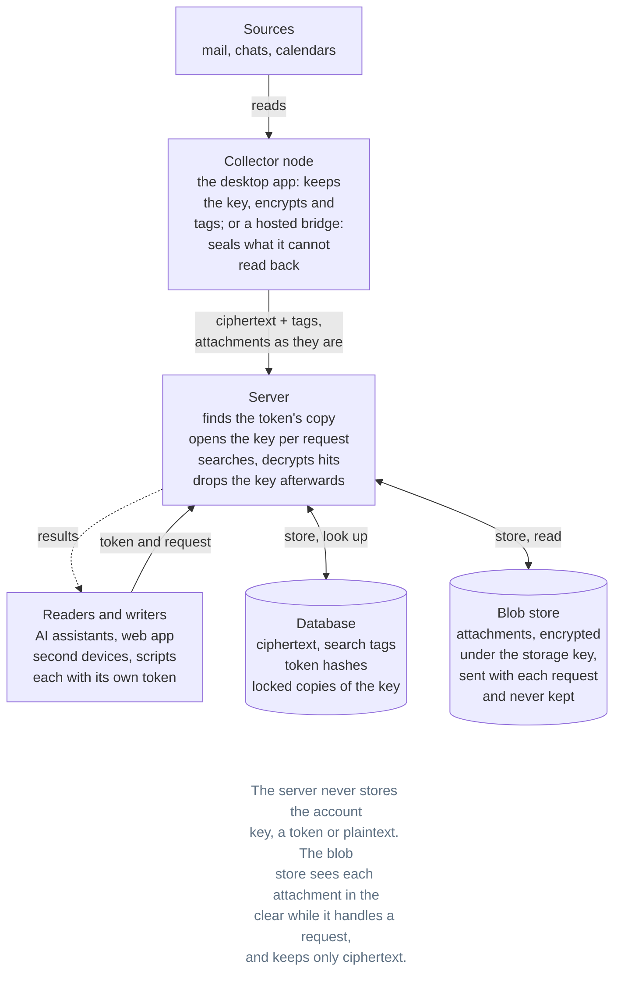

## Figure 5.1. The chain of joins: who can read at each join point, and what sets each hop's guarantee

*Each join decides who can read; end-to-end encryption ends at the mirror*

In [5. How it works](08-how-it-works.md). The chain of joins. Sources (end-to-end encrypted chats, hosted mail, calendars, contacts and device clouds) feed the collector node. On that hop the guarantee is set by the chat's own protocol, or by the source's provider. At the collector node, with the desktop node only the user's devices can read, and with a hosted bridge the bridge can read as well. The collector feeds the mirror. On that hop the guarantee is set by this design, encryption under the user's keys. At the mirror the server reads, inside an approved request only. End-to-end encryption ends here. From the mirror, data goes to an AI reader, where the AI provider reads and its terms and retention apply, and to a delivery channel, where the user sends an output, and that service and any recipient can read.

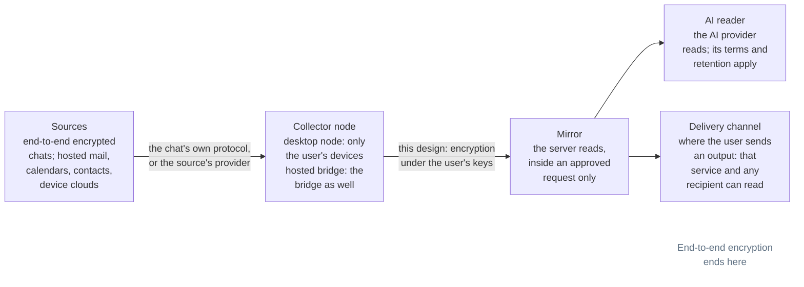

## Figure 5.2. Where the account key lives in the clear, and where only locked copies exist

*The account key exists in the clear in only three places*

In [5. How it works](08-how-it-works.md). Where the account key lives, where only a locked copy lives, and where it never goes. In the clear, the key exists only in the desktop OS keystore, at rest on each approved desktop and made on the first one, in server memory, with its derived keys, for one approved request only, and in an attested worker, in memory for the length of its lease, if the user unlocks one. Only a locked copy is in the database, one copy per approved token wrapped under a key from it, and in backups, where deleted copies stay until the backup expires, up to 30 days. The AIs, web app and scripts hold a token but never the key, and the server unlocks it for them. AI providers see only the results they asked for. A hosted bridge holds a bridge key derived from the account key, for its lease, never the key itself. Logs and operator staff hold no key, no token and no plaintext. A token opens only its own copy, so deleting that copy cuts its holder off at once. With a hosted bridge the key still rests only on the user's desktop, and the bridge holds a derived key.

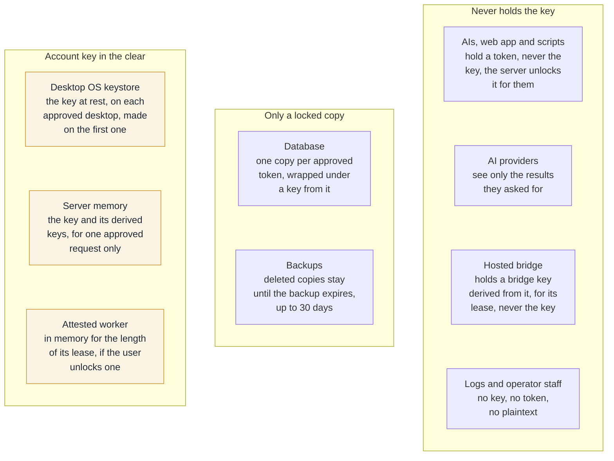

## Figure 5.3. Two ways to collect: the desktop node and the hosted bridge write into one mirror

*Two collectors, one mirror: the bridge can write but not read back*

In [5. How it works](08-how-it-works.md). Two ways to collect. Both are unlocked only by the user's key and write into the same mirror. The sources (hosted mail, calendars, contacts, device clouds and encrypted chats) feed either the desktop node or the hosted bridge. The desktop node runs on the user's own machine, holds the account key, and encrypts and tags before upload. The hosted bridge runs on the service's machines, is locked until the user's device unlocks it on a lease, and seals messages it cannot read back. Both write to the mirror: the same mirror for both, under one account key, with one format at rest. An approved request opens each sealed message, re-encrypts it under the content key and computes its tags. Encrypted chats that need the vendor's own hardware or client are carried by the desktop node only.

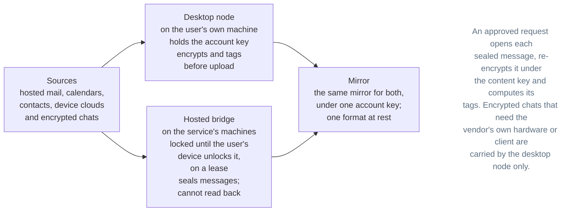

## Figure 5.4. Create: the desktop makes the account key and uploads only a locked copy

*The account key is born on the desktop, and only a locked copy reaches the server*

In [5. How it works](08-how-it-works.md). Create. The desktop app generates the account key from 256 random bits and stores it in the OS keystore. It signs in and asks the server for a desktop token, and the server replies with one. The desktop app wraps the account key under a key derived from the token and sends the locked copy to the server, which stores the token's hash and the copy in the database. The account key never leaves the desktop in the clear.

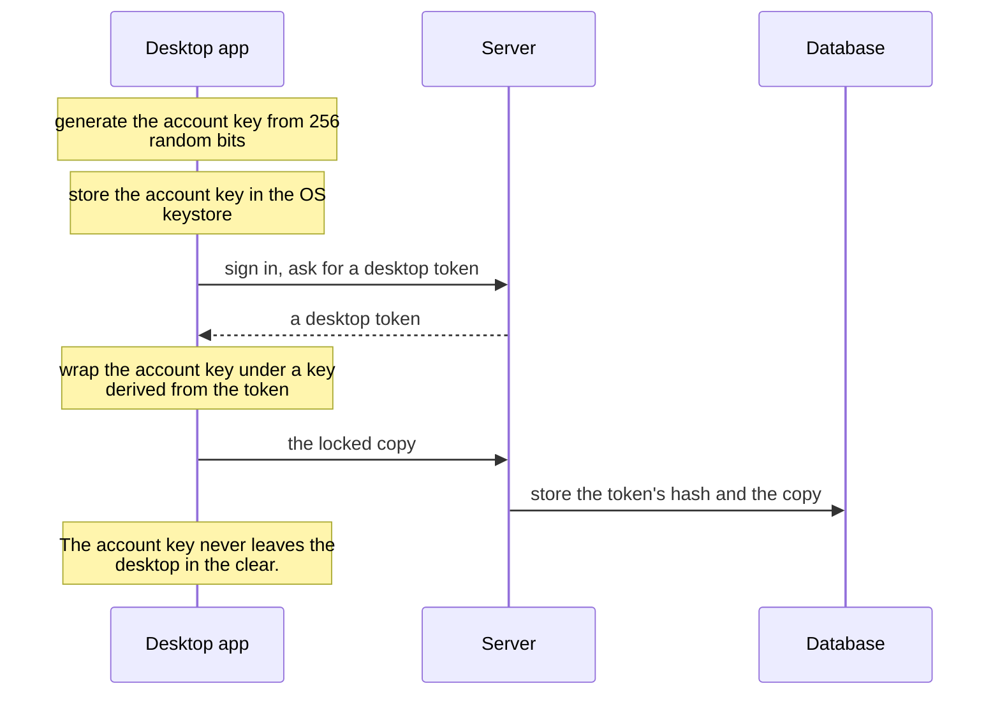

## Figure 5.5. Read: a token opens its copy of the account key for one request

*The account key is unwrapped for one request and never written down*

In [5. How it works](08-how-it-works.md). Read. A reader or writer sends a request carrying its token. The server looks up the token's hash in the database and gets back its locked copy. A key derived from the token unwraps the account key, in memory only. The server looks up the query's tags and gets back ciphertext rows, decrypts the candidates and builds the answer, and returns the results. The request ends and the account key is dropped.

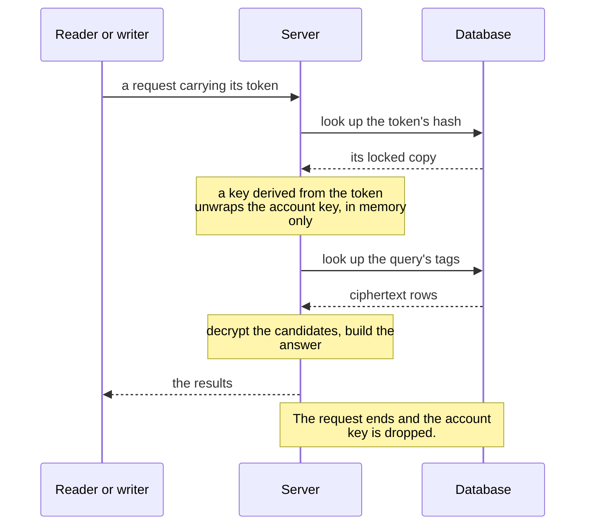

## Figure 5.6. Update: a new reader or writer gets its own token and its own locked copy

*A new holder gets its own copy, made inside the user's session*

In [5. How it works](08-how-it-works.md). Update. The user approves a new reader or writer, inside a session that holds the account key. The server makes a new token and wraps the account key under a key derived from it, stores the new token's hash and the copy in the database, and hands the new token to the reader or writer once. Renewal runs the same steps, then deletes the old token's hash and copy.

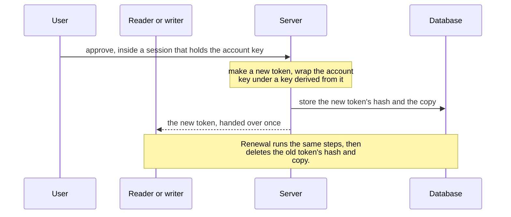

## Figure 5.7. Expire: an expired token is refused and its copy is deleted

*An expired token finds no copy and is refused*

In [5. How it works](08-how-it-works.md). Expire. The server finds copies past their expiry in the database and deletes each one's hash and copy. When a reader or writer then sends a request with the expired token, the server refuses it, and the holder must renew or be approved again. The account key itself is rotated before its nonce budget runs out, by re-encrypting or by re-wrapping data keys (questions 2 to 4).

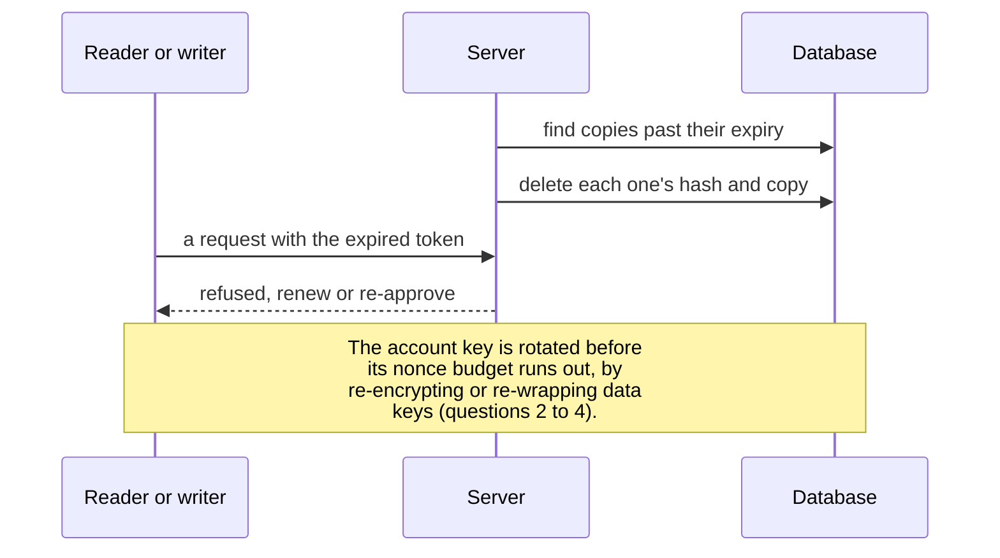

## Figure 5.8. Delete: access ends when a token's hash and its copy are deleted

*Deleting copies is how access ends*

In [5. How it works](08-how-it-works.md). Delete. The user revokes a token, or deletes the account. The server deletes that token's hash and copy, or every copy and row. Backups keep old copies until they expire, up to 30 days. If every holder is lost, the next desktop makes a new account key and collects again.

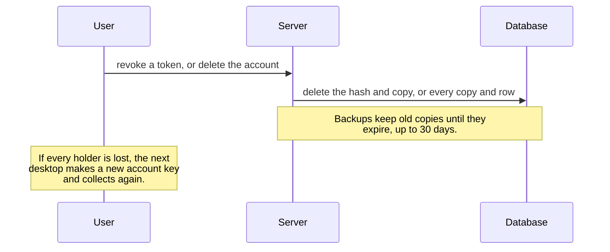

## Figure 5.9. Unlocking the hosted bridge: the user's device checks the image, then seals the bridge key under a lease

*The bridge stays locked until the user's device has checked what it runs*

In [5. How it works](08-how-it-works.md). Unlocking the hosted bridge. The hosted bridge starts locked: its state is ciphertext under the bridge key. On start it makes a one-time key pair and an attestation of its image. It sends the approved device an attestation binding the one-time public key to the image's measurement. The approved device checks the measurement against the published, append-only log of release images. It then sends the bridge the bridge key, sealed to the one-time public key. The unlock is a lease (proposed: 7 days). Approved devices renew it in the background. If none does, the bridge erases the bridge key and stops. After any restart the bridge is locked again until a device unlocks it.

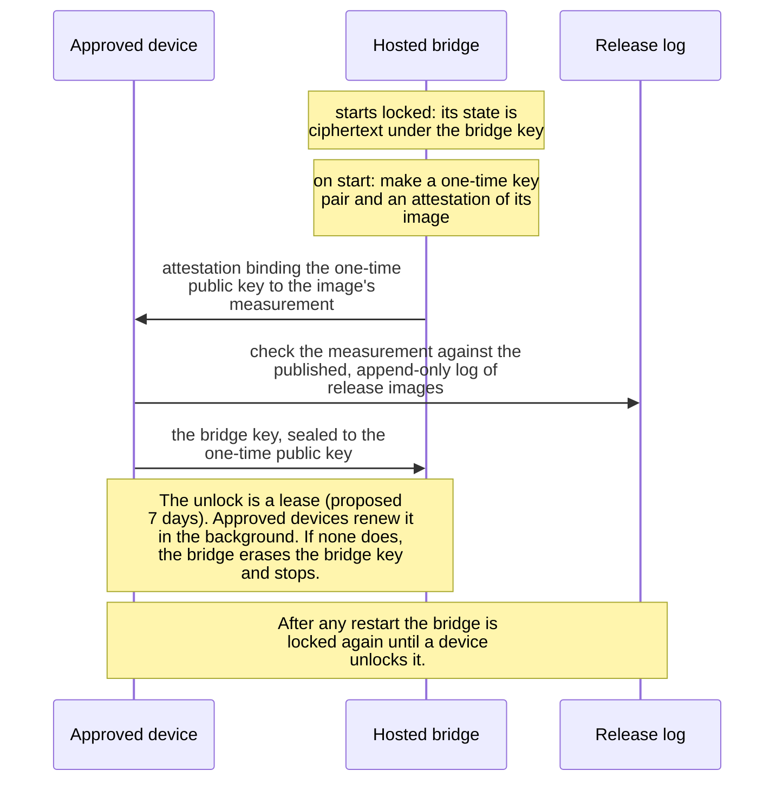

## Figure 5.10. Collect and push: messages are encrypted on the collector node before upload

*Messages are encrypted on the collector node before they leave it*

In [5. How it works](08-how-it-works.md). Collect and push. The collector node reads a new message from a source, such as mail, chat or calendar. It encrypts the message with the keys its model holds (5.1). It sends the encrypted message to the server over TLS. The server stores it and cannot read it. The message is searchable as soon as it is stored and tagged.

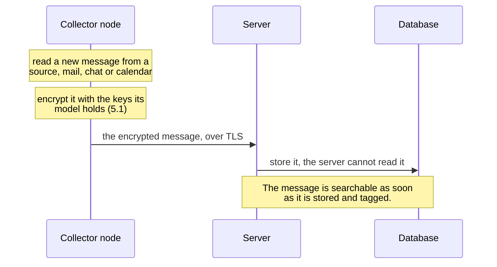

## Figure 5.11. Writing through the hosted bridge: each message is sealed to the account's public key

*The bridge seals each message to the account's public key and cannot read it back*

In [5. How it works](08-how-it-works.md). Writing through a hosted bridge. The collector node, as a hosted bridge, receives a message from a chat service as a linked device. It seals the message with HPKE to the account's public key and sends the sealed message to the server, which stores it in the database. The next approved request from a reader or writer, with its token, reaches the server. Inside that request the server opens the sealed message, re-encrypts it under the content key and computes its tags. It stores it in the database in the mirror's one format. Revoking the bridge ends its lease, unlinks its device from each chat service and rotates the bridge key.

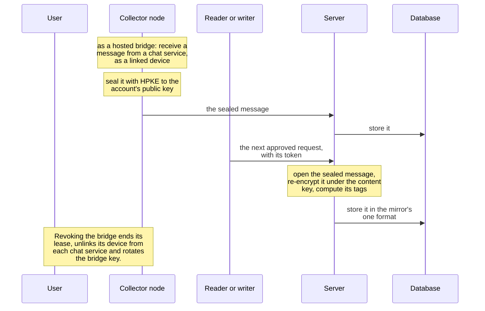

## Figure 5.12. Approve a reader or writer: one approval, one token, one locked copy

*Approving a reader or writer creates one token and one copy of the account key*

In [5. How it works](08-how-it-works.md). Approve a reader or writer. The user approves it by OAuth consent, by the web app opened from the desktop, or with a matching code. Inside the user's session, the server makes a token and a copy of the account key locked under it, stores the token's hash and the copy in the database, and hands the token to the reader or writer once.

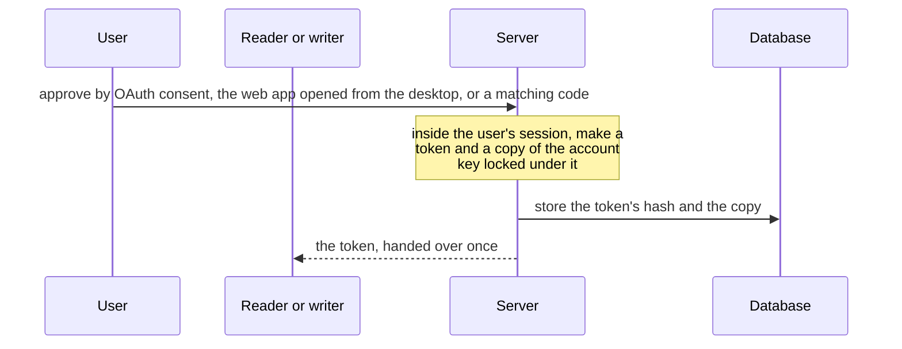

## Figure 5.13. Search and retrieve: the account key is opened for one request only

*The account key is unlocked for one request and dropped when it ends*

In [5. How it works](08-how-it-works.md). Search and retrieve. A reader or writer sends a query with its token. The server finds the token's copy by its hash, unlocks the account key for this request and turns the query into tags. It finds the candidates in the index and gets back candidate rows, still ciphertext. It decrypts only the candidates, checks the real match, and returns the results. The request ends and the account key is dropped.

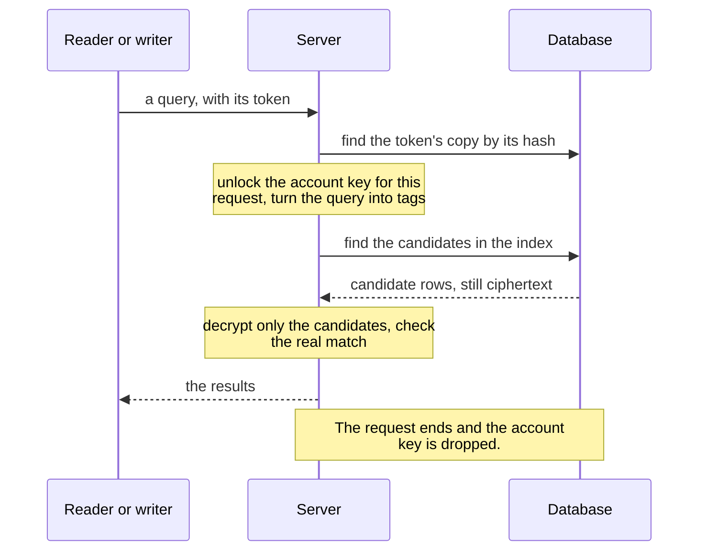

## Figure 5.14. Update: a writer's change is encrypted on the server inside its request

*A writer's change is encrypted on the server and seen on the next read*

In [5. How it works](08-how-it-works.md). Update. A reader or writer sends a change with its token, such as an AI tool call or a web-app edit. The server unlocks the account key, encrypts the change, recomputes its tags and stores it. On any reader's next request, the server returns the updated message.

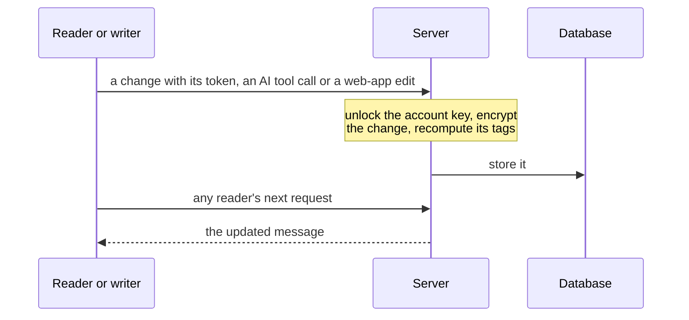

## Figure 5.15. Revoke and recover: one deletion cuts a holder off, and recovery needs another approved device

*Revoking deletes a copy, and recovery needs another approved device*

In [5. How it works](08-how-it-works.md). Revoke and recover. The user revokes a token, or a lost desktop, and the server deletes its hash and its copy in the database. A new desktop asks the server to join, the user approves the new desktop, and the server gives the new desktop its own token, which opens its own copy of the account key. If every holder is lost, the mirror cannot be read, and a new desktop makes a new account key and collects again from the sources.

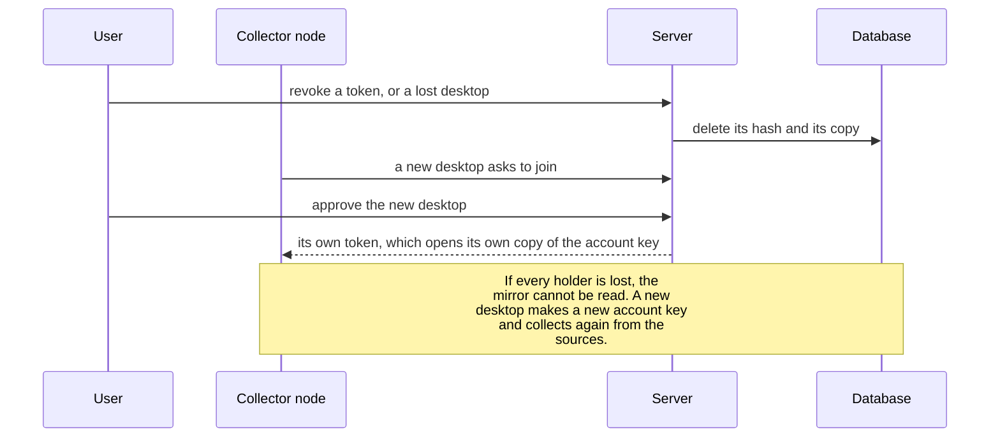

## Figure 5.16. Model outputs: stored as encrypted writes, delivered as a pointer unless the user chooses full text

*Model outputs are stored encrypted; full text leaves only by the user's choice*

In [5. How it works](08-how-it-works.md). Model outputs: where they are made, how they are stored and how they are delivered. Output is made in one of three places, in order of preference: in the user's open session, in the collector node's own push, or in an attested worker on a lease. It is stored as a write, encrypted under the content key with its own tags. It records its source rows, encrypted, and its titles and labels are included. It is delivered as a pointer by default: a notification links to it, and the text opens inside an approved session. Full text goes to a channel only where the user chooses, for each delivery, as labelled plaintext to that channel. Outputs are shown without remote content, and links are shown in full or limited to an allowlist. Deleting or revoking a source deletes, or marks for regeneration, what was derived from it.

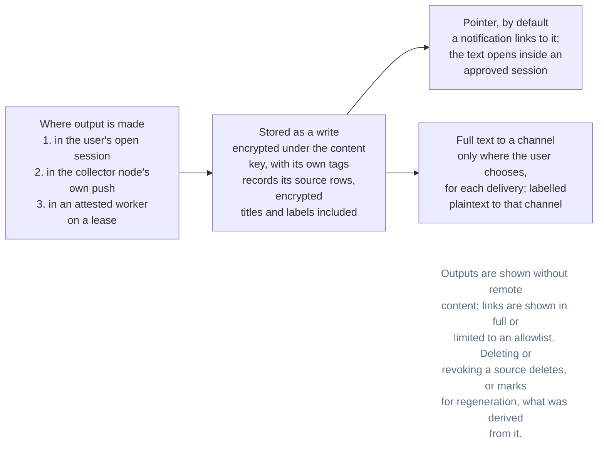

## Figure 6.1. Latency budget: targets at the 95th percentile, not measurements

*Encryption adds well under a second, and the answer lands inside the 10-second budget*

In [6. Latency budget](09-latency-budget.md). Question to first response is 7.4 seconds at the 95th percentile, of which the mirror is 0.405 seconds. These are targets, not measurements. The AI provider reads the question and calls the mirror in an assumed 3 seconds. The mirror then takes 0.405 seconds of its 1-second budget: 0.2 seconds for the request to the server and back over the network, 0.005 seconds on the server to find the token and unlock the key, 0.1 seconds in the database to look up the query's tags, and 0.1 seconds on the server to decrypt and check 200 candidates. The AI provider then writes the first words from the results in an assumed 4 seconds, so the first response arrives at 7.4 seconds, inside the 10-second budget.

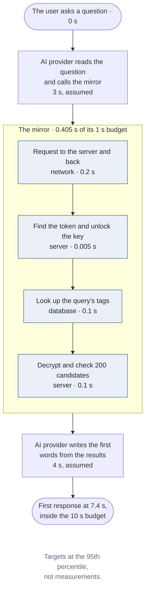

## Figure A.1. One shared database compared with one database per user

*Keys isolate stored data either way, and separate instances contain a breach*

In [Appendix A. Single or multi-tenant](13-appendix-a-single-or-multi-tenant.md). Each user's key stays on their desktop in both designs, and colours mark whose key locks which rows. With one shared database, users A, B and C, holding keys A, B and C, all use one shared server, which opens key A, B or C inside each user's request, and one shared database with row-level security, where user A's rows are locked under key A, user B's under key B and user C's under key C. A server breach sees every active user's requests. There is one system to run, and metadata is visible to the operator. With one instance per user, user A uses server A, which holds key A only, and database A, which holds user A's rows under key A, and the same for users B and C. A server breach sees one user's requests. There is one system per user to run and pay for.

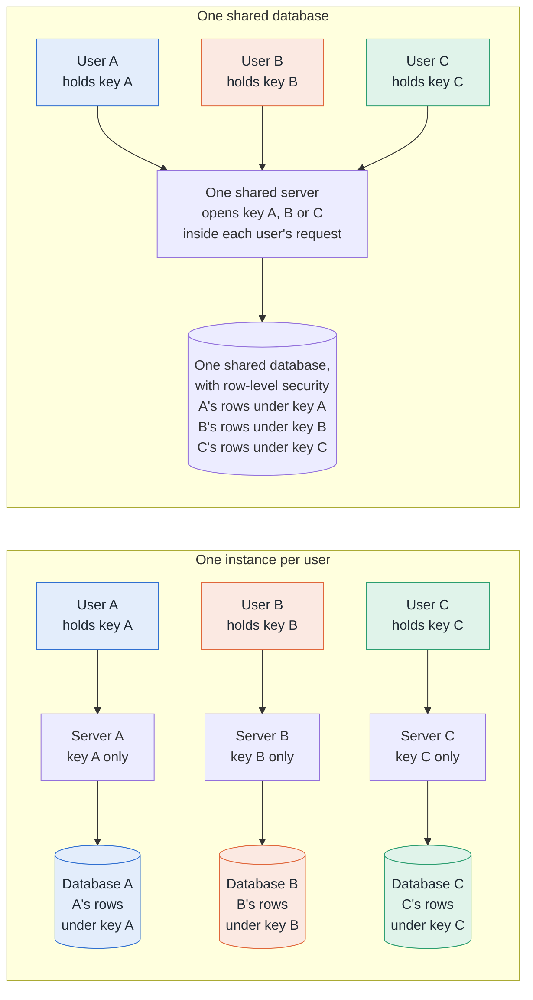
